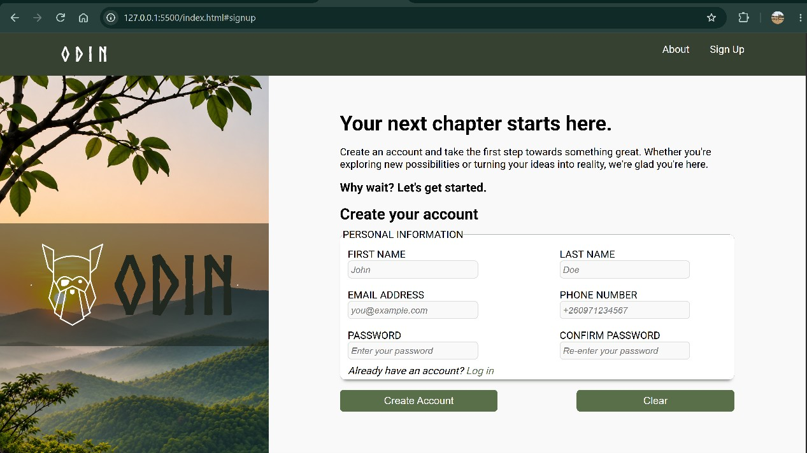

# sign-up-form# Odin Sign-up Form

A modern, minimalist sign-up form built with HTML, CSS and JavaScript as part of [The Odin Project](https://www.theodinproject.com/) Foundations curriculum.

The project focuses on creating a clean, responsive registration interface with accessible form controls, client-side validation and a nature-inspired visual design.

## Preview

<!-- Add your project screenshot here -->

## Live Demo

[View Live Demo](#)

## Features

- **Responsive Layout:** Two-column layout using CSS Grid, with responsive adjustments for smaller screens.
- **Minimalist Design:** Clean interface with a nature-inspired colour palette.
- **Custom Typography:** Google Fonts (Montserrat and Roboto) and a custom Norse font for branding.
- **Form Validation:** HTML5 validation using required fields, input types, patterns and password length constraints.
- **Zambian Phone Validation:** Validates mobile numbers using the `+260` country code and configured mobile prefixes.
- **Password Confirmation:** JavaScript validation to ensure both password fields match.
- **Accessible Form Controls:** Semantic HTML elements, associated labels and appropriate autocomplete attributes.
- **Visual Feedback:** Input focus and validation states using CSS pseudo-classes.
- **Image Background:** Landscape photography used to create a distinctive visual identity.

## Technologies Used

| Technology   | Purpose                                              |
| ------------ | ---------------------------------------------------- |
| HTML5        | Semantic structure and form elements                 |
| CSS3         | Styling, layout, Grid, Flexbox and responsive design |
| JavaScript   | Password confirmation and form interactions          |
| Google Fonts | Montserrat and Roboto typography                     |
| Httpbin      | Testing HTTP form submissions                        |
| Git & GitHub | Version control and project hosting                  |

## Design

The interface uses a simple, nature-inspired colour scheme.

### Colour Palette

| Colour       | Hex Code  | Usage                 |
| ------------ | --------- | --------------------- |
| Forest Green | `#596f49` | Primary elements      |
| Dark Green   | `#465a39` | Hover states          |
| Off White    | `#f8f9f8` | Main background       |
| Light Green  | `#e9ede7` | Secondary backgrounds |
| Dark Text    | `#202820` | Primary typography    |
| Muted Text   | `#687368` | Secondary typography  |

### Typography

- **Montserrat:** Headings and prominent text.
- **Roboto:** Body text, labels and form controls.
- **Norse:** Custom branding and logo.

## Form Validation

The form uses native HTML5 validation features:

- `required` for mandatory fields.
- `type="email"` for email validation.
- `type="tel"` and `pattern` for Zambian mobile number validation.
- `minlength` for password length requirements.
- JavaScript for password confirmation.

## Form Submission

The project uses [Httpbin](https://httpbin.org/) to test form submissions through its `/post` endpoint.

This allows submitted form data to be inspected without implementing a backend.

**Note:** Httpbin is used strictly for development and testing. Do not submit real passwords or sensitive personal information.

## Getting Started

### 1. Clone the repository

git clone <your-repository-url>

### 2. Navigate to the project directory

cd sign-up-form

### 3. Open the project

Open `index.html` in your browser or use the Live Server extension in Visual Studio Code.

No additional dependencies or build tools are required.

## Project Structure

sign-up-form/
│
├── index.html
│
├── css/
│ └── style.css
│
├── js/
│ └── script.js
│
├── assets/
│ ├── images/
│ └── assets/Norsebold.otf
│
└── README.md

_Adjust the directory structure above to match your actual project files._

## Learning Objectives

This project provides practical experience with:

- Writing semantic HTML5.
- Creating accessible forms using labels, fieldsets and legends.
- Understanding HTML form attributes and validation.
- Using CSS custom properties for consistent styling.
- Implementing layouts using CSS Grid and Flexbox.
- Working with CSS positioning and background images.
- Using CSS pseudo-classes for interactive form feedback.
- Handling form input and validation with JavaScript.
- Testing HTTP form submissions.
- Organising projects and tracking changes with Git.

## Future Improvements

- [ ] Add password visibility toggle.
- [ ] Improve password strength feedback.
- [ ] Add more comprehensive phone number validation.
- [ ] Improve form error messages.
- [ ] Implement asynchronous form submission using Fetch API.
- [ ] Build a backend authentication system.
- [ ] Add a login page.
- [ ] Improve accessibility and cross-browser compatibility.

## Acknowledgements

- [The Odin Project](https://www.theodinproject.com/) – Project inspiration and learning resources.
- [Google Fonts](https://fonts.google.com/) – Typography.
- [Httpbin](https://httpbin.org/) – HTTP request testing.

**Author:** Samson Mphande

**Project:** Odin Sign-up Form

**Status:** In Development
